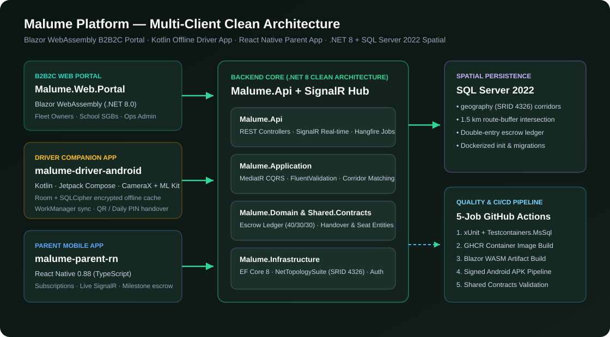
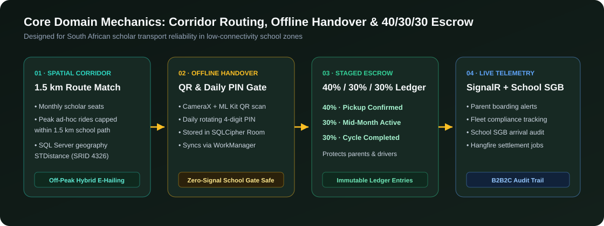

<div align="center">
  
  <h1>Malume Platform</h1>
  <p>
    <strong>South African Scholar Transport &amp; Hybrid E-Hailing Platform built with .NET 8 Clean Architecture, SQL Server 2022 Spatial, Blazor WebAssembly, Kotlin (Jetpack Compose), and React Native.</strong>
  </p>

  <p>
    
    
    
    
    
    <a href="LICENSE"></a>
  </p>

  <p>
    <a href="#-architecture-diagrams">Architecture Diagrams</a> •
    <a href="#-core-platform-features">Features</a> •
    <a href="#%EF%B8%8F-tech-stack--project-structure">Tech Stack</a> •
    <a href="#-getting-started">Getting Started</a> •
    <a href="malume_master_system_architecture_product_blueprint.md">System Blueprint</a>
  </p>
</div>

---

## What Is Malume?

**Malume** digitizes South African scholar transport and hybrid e-hailing into an auditable, safety-first platform connecting parents, drivers, fleet owners, and School Governing Bodies (SGBs).

It unifies **monthly recurring scholar seat subscriptions**, **1.5 km spatial corridor-constrained peak ad-hoc rides** (and off-peak e-hailing), **offline-first QR / daily rotating PIN child handover** (via encrypted SQLCipher Room storage for poor-signal school gates), and a **40% / 30% / 30% staged milestone escrow ledger**.

---

## 📐 Architecture Diagrams

<table>
  <tr>
    <td align="center" width="55%">
      <br />
      <sub><strong>System Architecture</strong> — Blazor WASM, Kotlin Driver App &amp; React Native Parent App backed by .NET 8 API + SQL Server Spatial</sub>
    </td>
    <td align="center" width="45%">
      <br />
      <sub><strong>Domain Flow</strong> — 1.5 km corridor matching, offline QR/PIN handover &amp; 40/30/30 staged escrow settlement</sub>
    </td>
  </tr>
</table>

---

## ✨ Core Platform Features

- **Hybrid Scholar + E-Hailing Dispatch**: Recurring monthly school seat subscriptions paired with **1.5 km corridor-constrained** peak ad-hoc seats and off-peak general rides using SQL Server `geography` (`SRID 4326`) + `NetTopologySuite`.
- **Offline-First Child Handover (Android Driver App)**: Drivers verify pickups and drop-offs at low-connectivity school gates using CameraX + ML Kit QR scanning or a daily rotating 4-digit PIN cached inside **Room + SQLCipher** and synced asynchronously via **WorkManager**.
- **40% / 30% / 30% Staged Milestone Escrow**: Protects both parents and transport operators by releasing monthly subscription funds across pickup verification, mid-month activity, and end-of-cycle completion.
- **B2B2C Web Portal (`Malume.Web.Portal`)**: Blazor WebAssembly console for platform administrators, fleet operators, and school SGB compliance oversight.
- **Automated Quality & 5-Job CI/CD**: GitHub Actions pipeline running xUnit + `Testcontainers.MsSql`, GHCR Docker image builds, Blazor WASM artifacts, and signed Android builds.

---

## 🛠️ Tech Stack & Project Structure

| Layer | Technology | Target Directory |
| --- | --- | --- |
| **Backend API & Real-Time** | ASP.NET Core `.NET 8.0` Web API, MediatR, FluentValidation, SignalR, Hangfire | [`src/Malume.Api`](src/Malume.Api) |
| **Database & Spatial Engine** | SQL Server 2022 + EF Core + `NetTopologySuite` (`geography`, SRID 4326) | [`infra/docker/`](infra/docker), [`src/Malume.Infrastructure`](src/Malume.Infrastructure) |
| **B2B2C Web Portal** | Blazor WebAssembly (`.NET 8.0`) | [`src/Malume.Web.Portal`](src/Malume.Web.Portal) |
| **Driver Companion App** | Native Android (Kotlin, Jetpack Compose, Room + SQLCipher, CameraX + ML Kit, WorkManager) | [`mobile/malume-driver-android`](mobile/malume-driver-android) |
| **Parent Mobile App** | React Native `0.88` (TypeScript) | [`mobile/malume-parent-rn`](mobile/malume-parent-rn) |
| **Automated Testing** | xUnit, Shouldly, NSubstitute, `Testcontainers.MsSql` | [`tests/`](tests) |
| **CI/CD Pipeline** | GitHub Actions (5-job validation & artifact pipeline) | [`.github/workflows/ci-cd-main.yml`](.github/workflows/ci-cd-main.yml) |

### Repository Layout

```text
Malume/
├── .github/workflows/ci-cd-main.yml                     # 5-job CI/CD pipeline
├── Directory.Build.props                                # Shared net8.0, Nullable & analyzers
├── Directory.Packages.props                             # Central Package Management (CPM)
├── Malume.sln
├── malume_master_system_architecture_product_blueprint.md
├── docs/
│   ├── diagrams/                                        # SVG architecture & escrow diagrams
│   ├── adr/0001-platform-baseline-and-governance.md
│   └── setup/                                           # Local dev & Visual Studio guides
├── infra/
│   ├── docker/                                          # SQL Server 2022 spatial Compose + .env.example
│   └── sql/init-database.sql
├── mobile/
│   ├── malume-driver-android/                           # Native Android (Kotlin + Compose)
│   └── malume-parent-rn/                                # React Native 0.88 (TypeScript)
├── src/
│   ├── Malume.Api/
│   ├── Malume.Application/
│   ├── Malume.Domain/
│   ├── Malume.Infrastructure/
│   ├── Malume.Shared.Contracts/
│   └── Malume.Web.Portal/
└── tests/
    ├── Malume.Api.IntegrationTests/
    ├── Malume.Application.Tests/
    └── Malume.Domain.UnitTests/
```

---

## 🚀 Getting Started

### Prerequisites
- **.NET 8.0 SDK** (`global.json` pins `8.0.100` with `rollForward: latestFeature`)
- **Docker Desktop** (for SQL Server 2022 container & Testcontainers)
- **Android Studio / JDK 17** and **Node.js 20+** for mobile apps

### 1. Clone, Start SQL Server & Restore
```bash
git clone https://github.com/KevinAsanda/Malume.git
cd Malume
cp infra/docker/.env.example infra/docker/.env
docker compose -f infra/docker/docker-compose.yml up -d
dotnet restore Malume.sln
```

### 2. Run API, Blazor Portal & Test Suite
```bash
dotnet test Malume.sln
dotnet run --project src/Malume.Api/Malume.Api.csproj
dotnet run --project src/Malume.Web.Portal/Malume.Web.Portal.csproj
```

> See [`docs/setup/local-development.md`](docs/setup/local-development.md) and [`malume_master_system_architecture_product_blueprint.md`](malume_master_system_architecture_product_blueprint.md) for full architecture and roadmap details.

---

## 📄 License

Distributed under the **MIT License**. See [`LICENSE`](LICENSE) for details.
